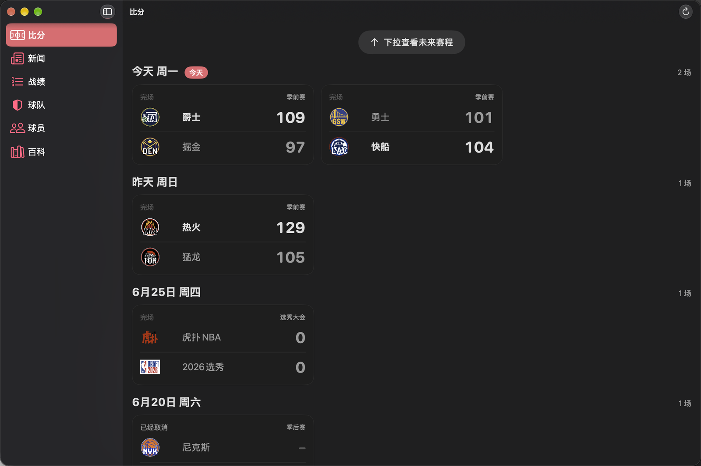
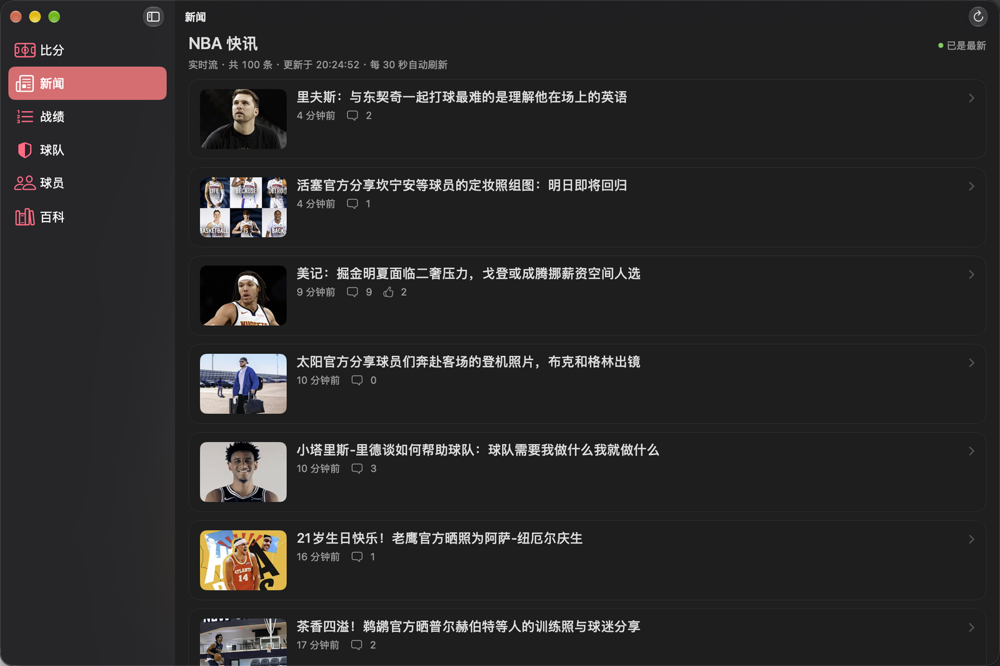
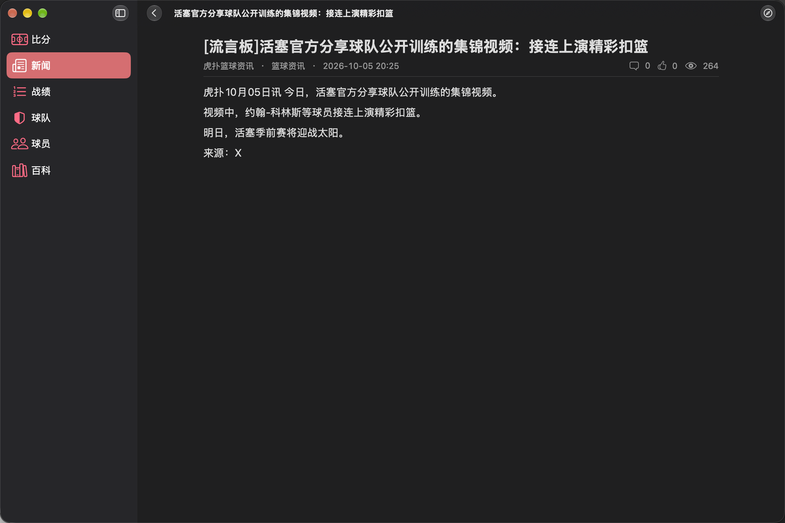
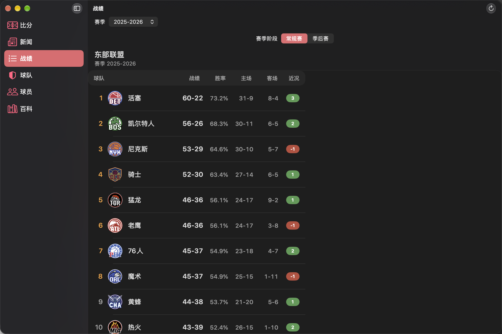
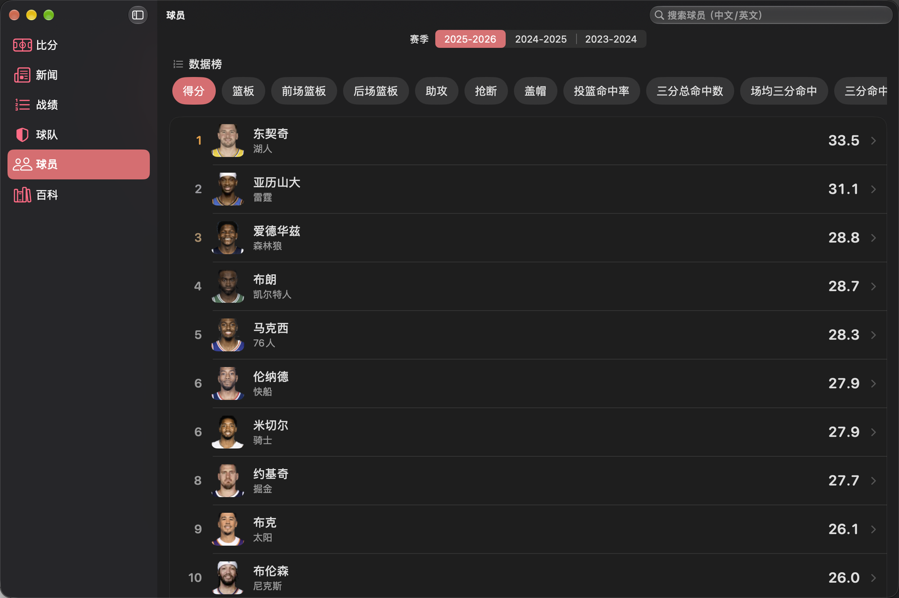
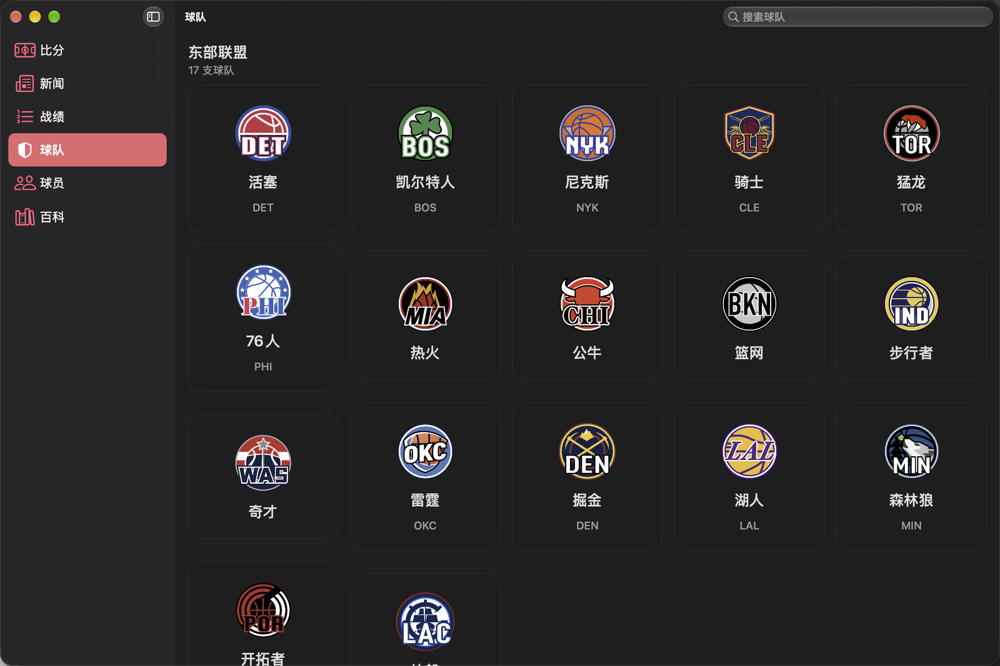
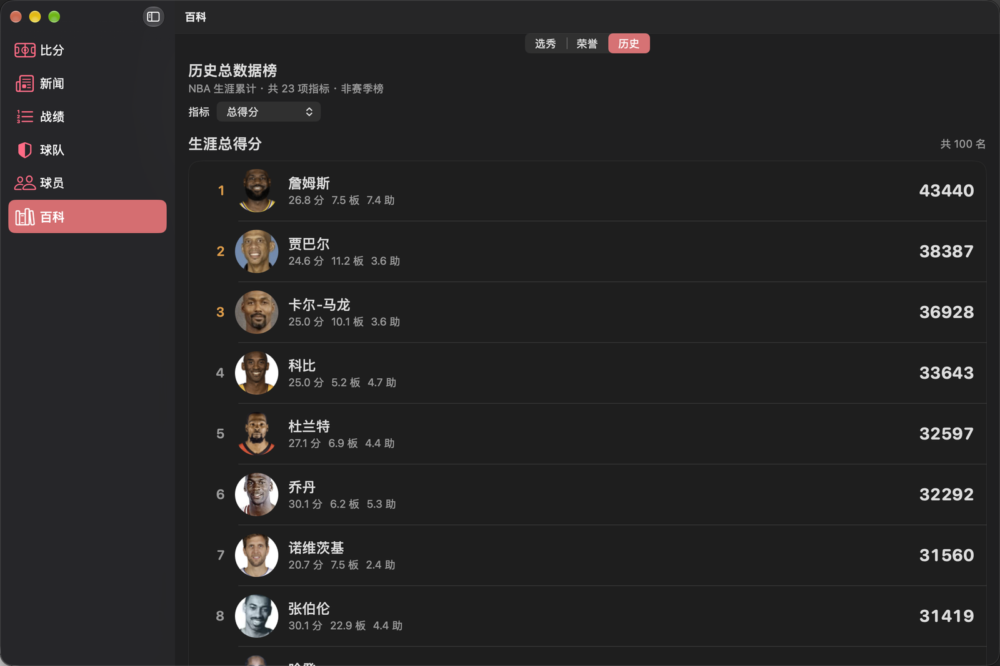
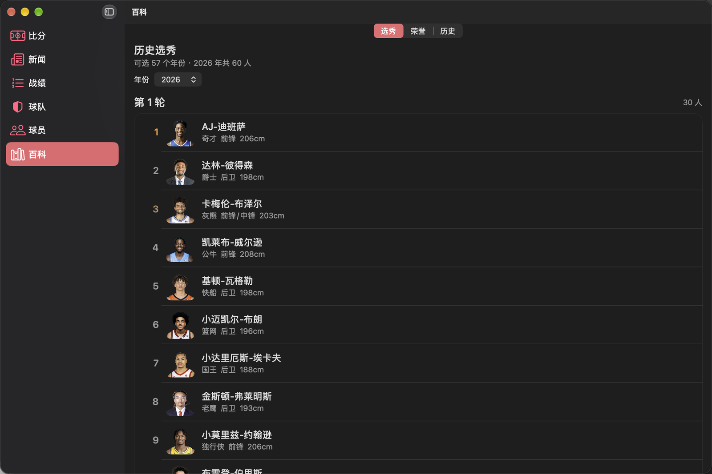

<div align="center">
  
  <h1>NBA</h1>
  <p><b>用原生 SwiftUI 重写的 NBA 资讯与数据客户端</b></p>
  <p>macOS · iPadOS · iOS —— 一份代码，三个平台</p>
  <p>
    <a href="#-功能"><b>功能</b></a> ·
    <a href="#-预览"><b>预览</b></a> ·
    <a href="#-构建"><b>构建</b></a> ·
    <a href="#-下载"><b>下载</b></a> ·
    <a href="#-实现要点"><b>实现要点</b></a>
  </p>
  <p>
    
    
    
    
    
  </p>
</div>

---

不是网页套壳，不是 Electron —— 整个界面由 SwiftUI 视图直接渲染：macOS 走原生
`NavigationSplitView` 侧边栏，iOS / iPadOS 走系统底部标签栏，深浅色自动跟随系统。
一个 Xcode target 同时编译出三个平台，平台差异只收敛在少量 `#if os(...)` 里。

数据来自虎扑公开接口（免签名、免 key），由自带的 `NBAKit` Swift Package 统一负责
缓存、重试与容错解码；`swift test` 有 **42 个用例逐个打真实接口**保证模型与线上同步。

## ✨ 功能

| 栏目 | 内容 |
|---|---|
| 🏀 **比分** | 日期条筛选当日赛程（默认今天）、30s 自动刷新、直播中标记；比赛详情含比分头图（球队主题色渐变）、两队技术统计条形对比、球员 boxscore（趣味标签/首发/正负值）、逐回合文字直播（12s 轮询） |
| 📰 **新闻** | **实时资讯流**：每 30 秒静默轮询（固定 100 条、最新通常 1–2 分钟前）、置顶标识、相对时间、游标往回翻更早的新闻；点进文章 **App 内阅读** —— 正文图文、热门回复、回复/点赞/浏览数，不跳浏览器 |
| 📊 **战绩** | 东西部排名（战绩/胜率/主场/客场/连胜，季后赛线标金）、常规赛与季后赛切换；球队数据榜 27 项指标 × 3 个赛季 |
| 🛡️ **球队** | 30 队列表（按当前战绩排序）；球队详情含简介、赛季数据（含联盟排名）、阵容（伤病标记、薪资）、球队荣誉、退役球衣、队史纪录保持者 |
| 🧑‍🦲 **球员** | 32 项数据榜（一次请求全取，切换指标零请求）、中英文搜索（防抖 280ms）；球员详情含资料/合同/薪资、赛季数据、生涯累计与最高、逐赛季、逐场、荣誉 |
| 📚 **百科** | 1970–2026 共 57 届选秀名单（按轮次分组，附生涯数据）、20 类历届荣誉得主、**历史总数据榜** —— NBA 生涯累计 23 项指标（非赛季榜），如生涯总得分：詹姆斯 43440 |

**系统集成细节**：

- 自定义应用图标（Icon Composer `.icon` bundle），完整支持 **default / dark / tinted** 三套外观
- iOS 自适应启动图（原生 launch storyboard，Auto Layout 随屏幕缩放，非自建遮罩）
- SF Symbols 图标体系、`Refreshable` 下拉刷新、系统材质卡片随深浅色切换
- 队徽 / 球员头像 / 文章配图走内存 + 磁盘两级缓存，弱网不重复下载

## 📸 预览

| | |
|:---:|:---:|
|  |  |
| **比分** — 日期分组赛程 | **新闻** — 30 秒轮询的实时资讯流 |
|  |  |
| **新闻** — 正文 App 内阅读 | **战绩** — 东西部排名 |
|  |  |
| **球员** — 多指标数据榜 | **球队** — 东西部球队网格 |
|  |  |
| **百科 · 历史** — 生涯累计总数据榜 | **百科 · 选秀** — 按年份回看每一届 |

## 🔨 构建

需要 **macOS 26+ / Xcode 26+**（Swift 6）与 [xcodegen](https://github.com/yonaskolb/XcodeGen)：

```bash
git clone https://github.com/Mora-han/NBA.git
cd NBA

./Scripts/build.sh              # macOS Release → build/apps/NBA.app（双击即用）
./Scripts/build.sh --with-ios   # 额外产出 iOS 模拟器包
./Scripts/build.sh --debug      # Debug 配置
```

也可以直接用 Xcode：`xcodegen generate` 后打开 `NBA.xcodeproj`。
签名默认 ad-hoc（模拟器 / 本机直接跑）；真机或上架时在 Signing & Capabilities 里选自己的 Team。

改动数据层后跑接口测试（**42 个用例逐个调用真实接口并断言关键字段**，需要网络）：

```bash
cd Packages/NBAKit && swift test
```

### 版本管理与回退

```bash
./Scripts/revert.sh snapshot "说明文字"   # 存一个可回退的版本点（改完随手存）
./Scripts/revert.sh list                  # 列出所有版本点
./Scripts/revert.sh diff v1               # 看与某个版本点的差异
./Scripts/revert.sh back v1               # 回退到 v1（会自动存 recover 分支，可切回）
```

## 📦 下载

- **macOS**：[Releases](https://github.com/Mora-han/NBA/releases) 页下载 `NBA-1.3.0-macOS.zip`，
  解压后拖进「应用程序」。**Intel + Apple Silicon 通用**二进制。
  本机 ad-hoc 签名、未经公证，首次打开请 **右键 → 打开**，或执行 `xattr -cr /Applications/NBA.app`。
- **iOS / iPadOS**：源码用 Xcode 打开、选自己的签名团队即可安装到设备。

## 🧱 目录结构

```
NBA/
├── project.yml                    XcodeGen 工程定义（唯一手写的工程配置）
├── Scripts/build.sh               一键编译出 macOS .app
├── Scripts/revert.sh              版本管理：存版本点、回退、查看差异
├── AGENTS.md                      协作规则：改动后必编译、数据层改动必跑测试
├── AppIcon.icon/                  Icon Composer 图标 bundle（default/dark/tinted）
├── Assets.xcassets/               AccentColor / Splash 启动图素材与色板
├── Resources/LaunchScreen.storyboard  iOS 自适应启动图（按 SDK 条件只编进 iOS）
├── docs/screenshots/              README 截图
├── Sources/
│   ├── App/                       @main、六栏目路由、mac 侧边栏 / 移动端底部标签栏
│   ├── Components/                Theme、RemoteImage（两级缓存）、CommonViews、StatsTable、Loader
│   └── Features/                  scores / news / standings / teams / players / encyclopedia
└── Packages/NBAKit/               数据层（可独立复用 / 单测）
    ├── Sources/NBAKit/
    │   ├── Network/               配置、接口枚举、客户端（缓存/重试/SSR 正文解析）
    │   ├── Models/                全部数据模型（FlexString 容错解码）
    │   ├── Registry/              30 队静态表、赛季推断
    │   └── Resources/teams.json   30 队 id / 名称 / 队徽
    └── Tests/NBAKitTests/         42 个真实接口解码测试
```

## 🔍 实现要点

**多平台单 target。** `SDKROOT=auto` + `SUPPORTED_PLATFORMS="iphoneos iphonesimulator macosx"`，
一套源码同时编译三个平台。平台差异全部收敛在少量 `#if os(...)` 与修饰符里
（`Theme` 的颜色、`inlineNavigationTitle()`、`pageBackground()`、`RemoteImage` 的 `UIImage`/`NSImage`），
其余代码 100% 共用。macOS 用 `NavigationSplitView` 原生 source list，iOS / iPadOS 用系统
`TabView` 底部标签栏 —— 两种形态都由系统渲染，毛玻璃与选中态不自己实现。

**实时新闻两路接口分工。** 列表走 `news/v2/MSite`（固定 100 条、覆盖近 4 小时、
最新 1–2 分钟前），往回翻历史才走 `news/v2/newsList` 游标分页 —— 单用后者首页会滞后几十分钟。
页面可见期间每 30 秒绕过缓存轮询，新条目按发布时间倒序插入并亮「+N 条新内容」角标。

**新闻正文直接解析 SSR。** `m.hupu.com/bbs/{tid}.html` 是 Next.js 服务端渲染，
从 `<script id="__NEXT_DATA__">` 的 JSON 里拿正文与热门回复，不需要任何签名头
（带签名的 `bbsintapi` 反而会返回「系统异常」）。

**生涯榜与赛季榜是两套端点。** 历史总数据榜用 `grain=totals` 的生涯累计（23 项指标），
与赛季场均榜（`perGame` 19 项）互不混淆；分页端点拼写是
`singleDimensionPlayerCareerRank`（近似拼写会静默返回 `null`）。

**数据层。** 虎扑接口有四种响应信封（标准 `result`/`success`、`salary` 的 `status`、
`teamBasicInfo`/`teamSeasonStats` 的平铺、`searchPlayer` 的顶层数组），`HupuClient.decode`
统一兼容；`FlexString` 把「同一字段时而数字、时而字符串」的脏数据统一成可选值，虎扑改字段不会崩。
整条「请求 + 解码」跑在 `Task.detached`，不占主线程；指数退避重试 3 次，
按数据类型设 TTL（比分 20s、直播 8s、战绩 60s、榜单 300s、阵容 600s、新闻 120s、实时流 20s、百科 6h）。

**性能。** 32 项球员榜单（163KB）一次取回后按「赛季 + 指标」缓存在内存，切换指标零请求；
比赛详情一次并发 4 个请求（比分、对比统计、主客 boxscore）；文章正文 TTL 1 小时，
列表重进不重新拉取。

**正确性由测试保证。** `swift test` 的 42 个用例逐个调用真实接口并断言关键字段，
模型与线上响应不同步会立刻失败。开发中它已经抓到过多个真实问题：
`shirtRetiredColors` 是字典不是数组、`playerCareerStats` 的阶段 map 与 `playerSeasonStats` 同名不同层、
`standings` 返回未开赛赛季（30 队全 0-0）、`playerSeasonRank` 的进阶指标只有前 5 名、
正文 `hits`/`replies` 有时是字符串。

## ⚠️ 已知限制

- **数据本身的新鲜度取决于数据源。** 例如 `playerInfo` 返回的年龄/身高可能是旧值（库里返回 38 岁），
  App 不做二次推算，避免引入自己的误差。
- **赛季切换期的战绩。** 新赛季开赛前虎扑会返回新赛季但所有球队 0-0，
  此时 `SeasonProvider` 采信按日期推断的赛季，并在标题标注「尚未开赛」。
- **实时新闻流固定 100 条**（约 4 小时），更早的内容靠「加载更早的新闻」游标往回翻。
- **`pace`（回合数）指标**没有完整榜单，已从球队数据榜菜单中过滤。
- **文字直播只展示最近 40 条**，接口本身返回全场数据。
- 队徽/球员图有部分 `http://` 明文地址，客户端加载时统一升级为 `https://`；
  Info.plist 保留了 ATS 放行项。

## ⚠️ 数据与免责

数据来自虎扑公开接口，本项目**与虎扑无任何关联**，仅用于学习与技术交流；
请勿用于商业用途。接口的可用性、字段结构不作保证，以线上实际返回为准。

## 📄 License

[MIT](LICENSE) © Little Code Sauce
